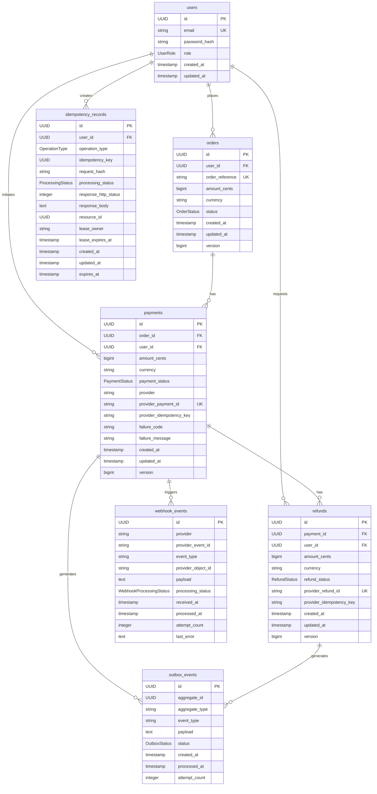
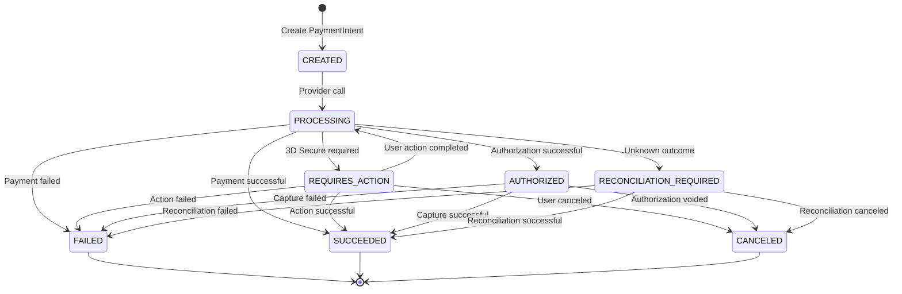
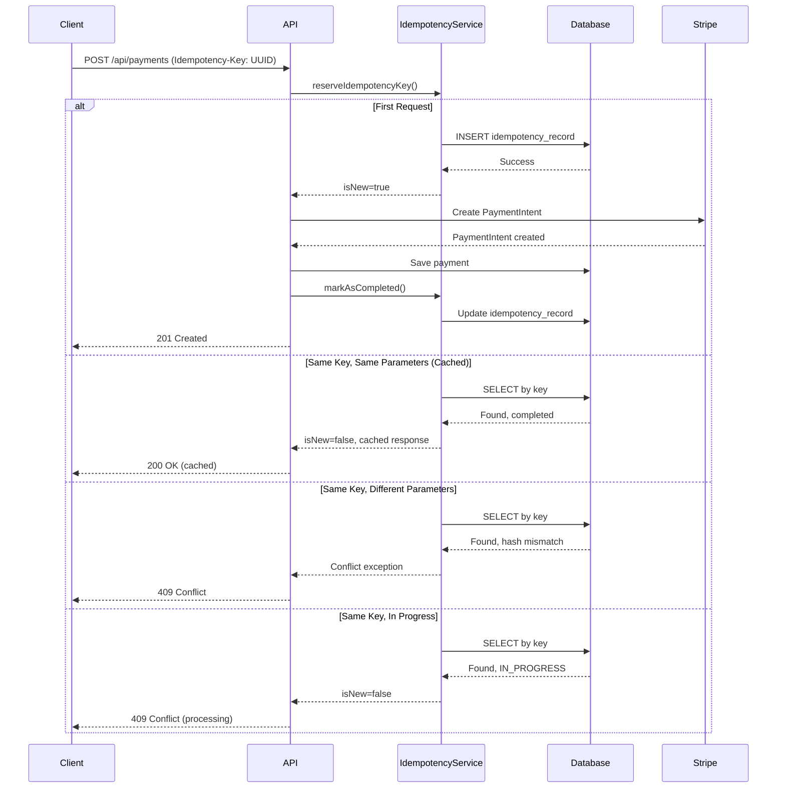
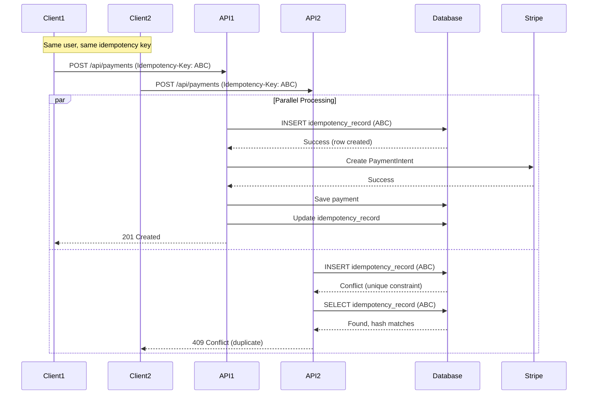
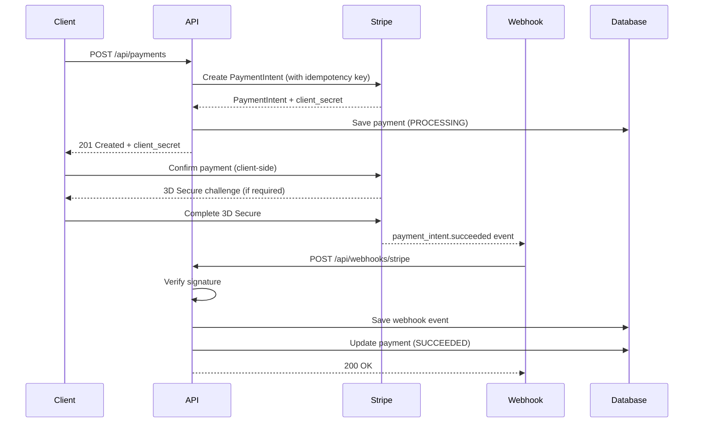
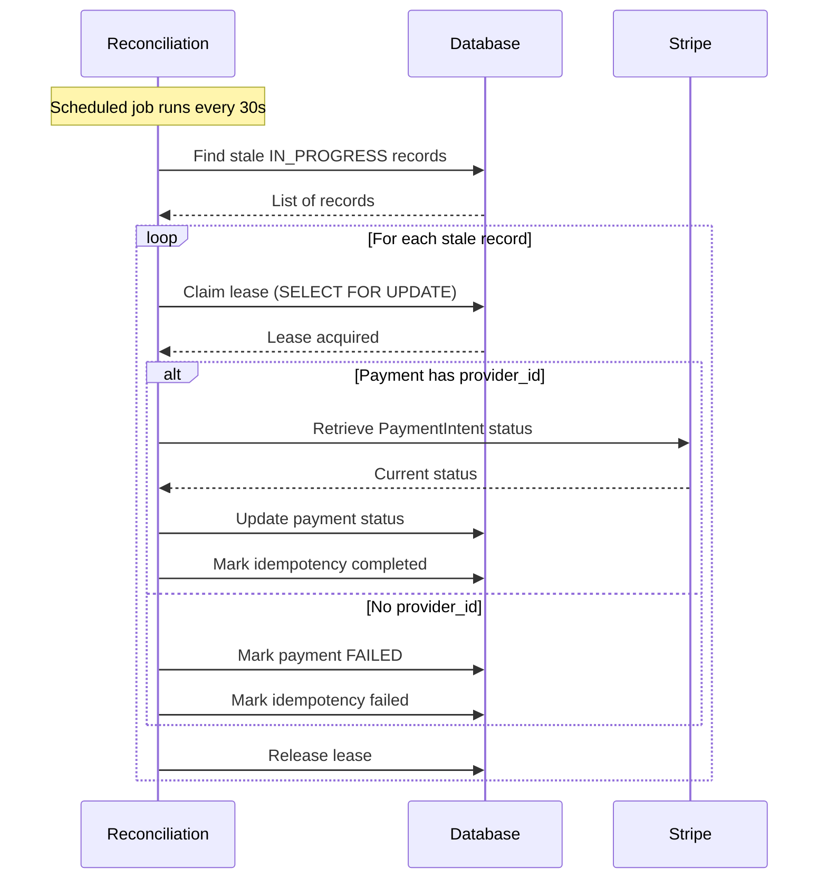

# Payment API with Idempotency

A production-grade payment processing REST API built with Spring Boot, Kotlin, PostgreSQL, and Stripe integration. The system guarantees that retries of the same logical payment operation do not initiate duplicate payment execution.

## Overview

This API provides a complete payment processing solution for e-commerce systems with the following capabilities:

- Order creation and management
- Payment initiation via Stripe PaymentIntents
- Idempotency protection against duplicate charges
- Refund processing with idempotency
- Webhook handling for Stripe events
- Crash recovery and reconciliation
- JWT-based authentication and authorization
- Outbox pattern for reliable event publishing
- Comprehensive observability with metrics and structured logging

## Architecture

The application follows a **Modular Monolith** with **Hexagonal Architecture (Ports and Adapters)** pattern:

```
src/main/kotlin/me/lokmvne/idempotency/
├── IdempotencyApplication.kt              # Main application entry point
│
├── shared/                                # Shared infrastructure
│   ├── config/                            # Configuration classes
│   ├── security/                          # Security (JWT, authentication)
│   ├── exception/                         # Base exceptions
│   ├── logging/                           # Logging and metrics
│   └── mapper/                            # Mappers
│
├── order/                                 # Order domain
│   ├── domain/
│   │   ├── model/                          # Order domain model
│   │   ├── enum/                           # OrderStatus enum
│   │   └── exception/                      # Order-specific exceptions
│   ├── application/
│   │   └── service/                       # Order business logic
│   └── infrastructure/
│       ├── persistence/                    # JPA entities and repositories
│       └── web/                            # REST controllers and DTOs
│
├── payment/                               # Payment domain
│   ├── domain/
│   │   ├── model/                          # Payment domain model
│   │   ├── enum/                           # PaymentStatus enum
│   │   ├── event/                          # Payment events
│   │   └── exception/                      # Payment-specific exceptions
│   ├── application/
│   │   ├── port/
│   │   │   ├── input/                      # Input ports (commands)
│   │   │   └── output/                     # Output ports (provider interfaces)
│   │   └── service/                       # Payment business logic
│   └── infrastructure/
│       ├── persistence/                    # JPA entities and repositories
│       ├── stripe/                         # Stripe adapter
│       ├── web/                            # REST controllers and DTOs
│       └── scheduling/                    # Reconciliation scheduler
│
├── idempotency/                           # Idempotency engine
│   ├── domain/
│   │   ├── model/                          # IdempotencyRecord domain model
│   │   └── enum/                           # OperationType, ProcessingStatus
│   ├── application/
│   │   └── service/                       # Idempotency business logic
│   └── infrastructure/
│       └── persistence/                    # JPA entities and repositories
│
├── refund/                                # Refund domain
│   ├── domain/
│   │   ├── model/                          # Refund domain model
│   │   └── enum/                           # RefundStatus enum
│   ├── application/
│   │   └── service/                       # Refund business logic
│   └── infrastructure/
│       └── persistence/                    # JPA entities and repositories
│
├── webhook/                               # Webhook handling
│   ├── domain/
│   ├── application/
│   │   └── service/                       # Webhook processing logic
│   └── infrastructure/
│       ├── web/                            # Webhook endpoints
│       └── persistence/                    # Webhook event storage
│
└── outbox/                                # Outbox pattern
    ├── domain/
    │   └── OutboxEvent                     # Outbox event model
    ├── application/
    │   └── service/                       # Outbox processing logic
    └── infrastructure/
        └── persistence/                    # Outbox event storage
```

### Architectural Principles

1. **Domain-Driven Design**: Business logic is organized by domain (Order, Payment, Refund)
2. **Hexagonal Architecture**: Infrastructure implements application ports
3. **Separation of Concerns**: REST DTOs are separate from database entities
4. **Immutable Domain Models**: Domain models use Kotlin data classes
5. **Constructor Injection**: All dependencies are injected via constructors
6. **No Circular Dependencies**: Modules are organized to avoid circular dependencies

## Database Schema

### Entity Relationship Diagram



### Key Constraints and Indexes

1. **Users**
   - Unique constraint on `email`
   - Foreign key from orders, payments, refunds, idempotency_records

2. **Orders**
   - Unique constraint on `order_reference`
   - Index on `user_id`, `status`, `created_at`
   - Foreign key to users

3. **Payments**
   - Unique constraint on `provider_payment_id` (prevents duplicate Stripe payments)
   - **Partial unique index** on `order_id` where `payment_status = 'SUCCEEDED'` (ensures one successful payment per order)
   - Indexes on `order_id`, `user_id`, `payment_status`, `provider_payment_id`, `created_at`
   - Composite index on `order_id, payment_status`
   - Foreign keys to orders and users

4. **Idempotency Records**
   - Unique constraint on `(user_id, operation_type, idempotency_key)` (scope for idempotency)
   - Indexes on processing status, expires_at, lease
   - Foreign key to users

5. **Refunds**
   - Unique constraint on `provider_refund_id`
   - Indexes on `payment_id`, `user_id`, `status`, `created_at`
   - Foreign keys to payments and users

6. **Webhook Events**
   - Unique constraint on `(provider, provider_event_id)` (prevents duplicate webhook processing)
   - Indexes on provider_event_id, event_type, processing_status, received_at

7. **Outbox Events**
   - Indexes on status, aggregate, created_at

## Payment Lifecycle



## Idempotency Flow



## Concurrent Request Handling



## Stripe Integration Flow



## Crash Recovery



## Transaction Boundaries

The system uses distinct transaction boundaries to prevent long-running database transactions during external calls:

1. **Idempotency Reservation**: Separate transaction to atomically reserve the idempotency key
2. **Payment Creation**: Transaction that saves the payment record
3. **External Call**: Stripe API call happens **outside** database transaction
4. **Result Persistence**: Transaction that updates payment and idempotency record together
5. **Webhook Processing**: Transaction that persists webhook event and updates payment

### Why Database Transactions Cannot Roll Back Stripe

Stripe API calls are external operations that occur outside the database transaction boundary. Once a PaymentIntent is created in Stripe, it has been executed on Stripe's systems and cannot be rolled back by a database transaction. This is why:

- We create the local payment record in `PROCESSING` state before calling Stripe
- We rely on idempotency keys to prevent duplicate Stripe calls
- We use reconciliation to recover from unknown outcomes
- We treat Stripe operations as **at-least-once** not **exactly-once**

## Idempotency Implementation

### Key Features

1. **Atomic Key Reservation**: Uses PostgreSQL `INSERT ... ON CONFLICT` to atomically reserve keys
2. **Request Fingerprinting**: SHA-256 hash of canonical request parameters
3. **Scope**: `(user_id, operation_type, idempotency_key)` ensures user-scoped idempotency
4. **Lease Mechanism**: Prevents multiple workers from processing the same operation
5. **Response Caching**: Stores complete HTTP response for replay
6. **Expiration**: Configurable TTL for idempotency records

### Idempotency-Key Reuse Rules

- **Same key, same parameters**: Returns cached response (200 OK)
- **Same key, different parameters**: Returns 409 Conflict
- **Same key, while processing**: Returns 409 Conflict
- **Expired key**: New operation can be created, but order-level safeguards still apply

### Handling Expired Keys

When an idempotency key expires:
- The record is deleted from the database
- A new request with the same key creates a new operation
- **Order-level constraints** still prevent duplicate successful payments
- Provider-level idempotency keys (stable per operation) prevent duplicate charges

### At-Least-Once vs Effectively-Once

The system provides **effectively-once** semantics for the business operation:

- **At-least-once**: Webhook delivery, outbox event processing
- **Effectively-once**: Payment creation, refund creation (via idempotency)
- **Exactly-once**: Not guaranteed for arbitrary distributed operations

## Local Setup

### Prerequisites

- Java 21
- Gradle 8.x
- PostgreSQL 17+
- Docker (optional, for containerized setup)
- Stripe account (for real payments, optional for development)

### Environment Variables

Create a `.env` file (see `.env.example`):

```bash
# Database
DATABASE_URL=jdbc:postgresql://localhost:5432/payment_db
DATABASE_USERNAME=payment_user
DATABASE_PASSWORD=payment_password

# Stripe
STRIPE_MODE=stripe-test
STRIPE_API_KEY=sk_test_your_stripe_test_api_key
STRIPE_WEBHOOK_SECRET=whsec_your_webhook_signing_secret

# JWT
JWT_SECRET=your-secret-key-must-be-at-least-256-bits-long-for-hs256-algorithm
JWT_ISSUER_URI=http://localhost:8080

# Server
SERVER_PORT=8080
```

### Running with Docker Compose

```bash
# Start PostgreSQL and the application
docker compose up --build

# View logs
docker compose logs -f payment-api

# Stop everything
docker compose down
```

### Running Locally

```bash
# Install dependencies
./gradlew build

# Run the application
./gradlew bootRun

# Run with specific profile
./gradlew bootRun --args='--spring.profiles.active=dev'
```

### Database Migrations

Flyway migrations run automatically on startup. To run manually:

```bash
./gradlew flywayMigrate
```

## Stripe Test Mode

1. Sign up for a Stripe account: https://stripe.com/docs/keys#test-live-modes
2. Get your test API keys from the Stripe Dashboard
3. Set `STRIPE_API_KEY` to your test secret key (starts with `sk_test_`)
4. Use Stripe test cards: https://stripe.com/docs/testing#cards

### Stripe Webhook Testing Locally

Use the Stripe CLI to forward webhooks to your local machine:

```bash
# Install Stripe CLI
# https://stripe.com/docs/stripe-cli

# Login to Stripe
stripe login

# Forward webhooks to localhost
stripe listen --forward-to localhost:8080/api/webhooks/stripe

# This will give you a webhook signing secret to use in STRIPE_WEBHOOK_SECRET
```

## Testing

### Run All Tests

```bash
./gradlew test
```

### Run Unit Tests Only

```bash
./gradlew test --tests "*Test"
```

### Run Integration Tests Only

```bash
./gradlew test --tests "*IntegrationTest"
```

### Run Concurrency Tests

```bash
./gradlew test --tests "*ConcurrencyTest"
```

## API Documentation

Swagger UI is available at: `http://localhost:8080/swagger-ui.html`

OpenAPI spec: `http://localhost:8080/api-docs`

## API Examples

### Register User

```bash
curl -X POST http://localhost:8080/api/auth/register \
  -H "Content-Type: application/json" \
  -d '{
    "email": "user@example.com",
    "password": "securePassword123"
  }'
```

Response:
```json
{
  "token": "eyJhbGciOiJIUzI1NiIsInR5cCI6IkpXVCJ9...",
  "userId": "uuid",
  "email": "user@example.com",
  "role": "CUSTOMER"
}
```

### Login

```bash
curl -X POST http://localhost:8080/api/auth/login \
  -H "Content-Type: application/json" \
  -d '{
    "email": "user@example.com",
    "password": "securePassword123"
  }'
```

### Create Order

```bash
curl -X POST http://localhost:8080/api/orders \
  -H "Content-Type: application/json" \
  -H "Authorization: Bearer YOUR_JWT_TOKEN" \
  -d '{
    "amountCents": 10000,
    "currency": "USD"
  }'
```

Response:
```json
{
  "id": "order-uuid",
  "userId": "user-uuid",
  "orderReference": "ORD-1234567890-ABCDEF12",
  "amountCents": 10000,
  "currency": "USD",
  "status": "CREATED",
  "createdAt": "2024-01-01T00:00:00Z",
  "updatedAt": "2024-01-01T00:00:00Z"
}
```

### Create Payment

```bash
curl -X POST http://localhost:8080/api/payments \
  -H "Content-Type: application/json" \
  -H "Authorization: Bearer YOUR_JWT_TOKEN" \
  -H "Idempotency-Key: 550e8400-e29b-41d4-a716-446655440000" \
  -d '{
    "orderId": "order-uuid"
  }'
```

Response (first request):
```json
{
  "payment": {
    "id": "payment-uuid",
    "orderId": "order-uuid",
    "userId": "user-uuid",
    "amountCents": 10000,
    "currency": "USD",
    "status": "PROCESSING",
    "provider": "stripe",
    "providerPaymentId": "pi_1234567890",
    "createdAt": "2024-01-01T00:00:00Z",
    "updatedAt": "2024-01-01T00:00:00Z"
  },
  "clientSecret": "pi_1234567890_secret_abc123"
}
```

### Retry Payment (Same Idempotency Key)

```bash
curl -X POST http://localhost:8080/api/payments \
  -H "Content-Type: application/json" \
  -H "Authorization: Bearer YOUR_JWT_TOKEN" \
  -H "Idempotency-Key: 550e8400-e29b-41d4-a716-446655440000" \
  -d '{
    "orderId": "order-uuid"
  }'
```

Response (cached):
```json
{
  "payment": {
    "id": "payment-uuid",
    "orderId": "order-uuid",
    "userId": "user-uuid",
    "amountCents": 10000,
    "currency": "USD",
    "status": "SUCCEEDED",
    "provider": "stripe",
    "providerPaymentId": "pi_1234567890",
    "createdAt": "2024-01-01T00:00:00Z",
    "updatedAt": "2024-01-01T00:00:00Z"
  },
  "clientSecret": "pi_1234567890_secret_abc123"
}
```

### Get Payment Status

```bash
curl -X GET http://localhost:8080/api/payments/payment-uuid \
  -H "Authorization: Bearer YOUR_JWT_TOKEN"
```

### Create Refund

```bash
curl -X POST http://localhost:8080/api/payments/payment-uuid/refunds \
  -H "Content-Type: application/json" \
  -H "Authorization: Bearer YOUR_JWT_TOKEN" \
  -H "Idempotency-Key: 660e8400-e29b-41d4-a716-446655440001" \
  -d '{
    "amountCents": 5000
  }'
```

## Common Error Scenarios

### 409 Conflict - Idempotency Key Conflict

```json
{
  "type": "idempotency-conflict",
  "title": "Idempotency key conflict",
  "detail": "Idempotency key conflict for user xxx, operation CREATE_PAYMENT, key xxx",
  "userId": "uuid",
  "operationType": "CREATE_PAYMENT",
  "idempotencyKey": "uuid"
}
```

**Cause**: Same idempotency key used with different request parameters.

**Solution**: Use a new idempotency key for different requests.

### 422 Unprocessable Entity - Invalid State

```json
{
  "type": "domain-error",
  "title": "Domain error",
  "detail": "Order cannot be marked as paid in current status: PAID"
}
```

**Cause**: Invalid business state transition.

**Solution**: Check the current state of the resource before attempting the operation.

### 422 Unprocessable Entity - Refund Amount Exceeded

```json
{
  "type": "refund-amount-exceeded",
  "title": "Refund amount exceeds refundable amount",
  "detail": "Refund amount 10000 exceeds refundable amount 5000 for payment xxx",
  "paymentId": "uuid",
  "requestedAmount": 10000,
  "refundableAmount": 5000
}
```

**Cause**: Refund amount exceeds available refundable amount.

**Solution**: Check the payment amount and existing refunds.

## Security Considerations

1. **No Card Storage**: Card numbers and CVV are never stored on the backend
2. **Stripe Test Mode**: Development uses Stripe test mode only
3. **JWT Authentication**: All API endpoints (except auth and webhooks) require JWT
4. **Signature Verification**: Webhook signatures are verified before processing
5. **User Scoping**: All operations are scoped to the authenticated user
6. **Secrets Management**: No secrets in code, use environment variables
7. **SQL Injection**: Prevented by JPA parameterized queries
8. **CSRF**: Stateless JWT authentication, CSRF not applicable
9. **CORS**: Configure as needed for your frontend

## Production Readiness Checklist

- [ ] Change JWT secret to a strong, randomly generated value
- [ ] Configure production Stripe API keys
- [ ] Set up Stripe webhook endpoints in production
- [ ] Configure production database with proper security
- [ ] Enable HTTPS/TLS for all endpoints
- [ ] Configure proper logging levels (INFO for production)
- [ ] Set up monitoring and alerting (Prometheus, Grafana)
- [ ] Configure backup strategy for PostgreSQL
- [ ] Set up log aggregation (ELK, Splunk, etc.)
- [ ] Configure rate limiting on API endpoints
- [ ] Enable and configure CORS for your frontend domain
- [ ] Review and adjust connection pool sizes
- [ ] Configure proper JVM heap size for your workload
- [ ] Set up health check monitoring
- [ ] Configure disaster recovery procedures
- [ ] Review and test reconciliation processes
- [ ] Set up automated security scanning
- [ ] Configure secrets management (Vault, AWS Secrets Manager, etc.)

## Limitations and Guarantees

### Guarantees

1. **No Duplicate Charges**: Atomic database constraints and idempotency prevent duplicate charges for the same logical operation
2. **At-Least-Once Webhook Delivery**: Stripe webhooks are delivered at least once; duplicate webhooks are deduplicated
3. **Eventual Consistency**: Payment state is eventually consistent via webhooks and reconciliation
4. **Recovery from Crashes**: Unfinished operations are recovered by the reconciliation process
5. **User Isolation**: Users can only access their own resources

### Limitations

1. **Not Exactly-Once**: Arbitrary distributed operations are not exactly-once (industry limitation)
2. **Stripe Idempotency TTL**: Stripe idempotency keys expire after 24 hours
3. **Webhook Delivery**: Stripe does not guarantee webhook delivery order
4. **Provider Downtime**: Stripe outages will affect payment processing
5. **Partial Refunds**: Refunds are processed individually; batch refunds not supported
6. **Single Payment Provider**: Currently supports only Stripe
7. **No Partial Payments**: Orders must be paid in full; partial payments not supported
8. **Concurrent Refunds**: Multiple concurrent refund requests for the same payment are serialized

### Assumptions

1. PostgreSQL is the single source of truth for application state
2. Stripe PaymentIntents are the source of truth for payment status
3. Webhooks may arrive out of order and may be duplicated
4. Network calls to Stripe may fail or timeout
5. Application instances may crash at any point
6. Database transactions cannot roll back external side effects

## Monitoring

### Actuator Endpoints

- Health: `GET /actuator/health`
- Metrics: `GET /actuator/metrics`
- Prometheus: `GET /actuator/prometheus`

### Key Metrics

- `payments.created`: Total payments created
- `payments.succeeded`: Total payments succeeded
- `payments.failed`: Total payments failed
- `payments.duplicate_requests`: Duplicate idempotency requests
- `payments.idempotency_conflicts`: Idempotency key conflicts
- `payments.processing_duration`: Payment processing time
- `payments.provider_timeouts`: Stripe API timeouts
- `payments.reconciliation_attempts`: Reconciliation attempts
- `payments.reconciliation_failures`: Reconciliation failures
- `payments.webhook_duplicates`: Duplicate webhooks
- `payments.refunds`: Total refunds created

## Technology Stack

- **Language**: Kotlin 2.1.0
- **Framework**: Spring Boot 3.4.1
- **Build Tool**: Gradle 8.x with Kotlin DSL
- **Database**: PostgreSQL 17
- **ORM**: Hibernate / Spring Data JPA
- **Migrations**: Flyway
- **Payment Provider**: Stripe (Java SDK)
- **Authentication**: JWT (jjwt)
- **API Documentation**: SpringDoc OpenAPI
- **Metrics**: Micrometer + Prometheus
- **Testing**: JUnit 5, MockK, Testcontainers
- **Containerization**: Docker, Docker Compose

## License

MIT

## Support

For issues and questions, please open an issue on the GitHub repository.
